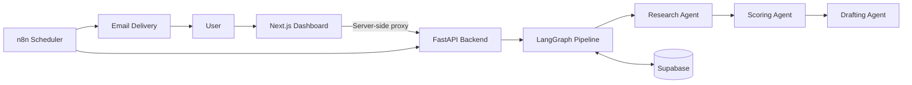

# ClientPilot

**AI-powered lead research, scoring, and outreach drafting with human approval.**

ClientPilot helps freelancers identify companies that may benefit from their services. It researches companies, evaluates their fit against a defined scoring rubric, and drafts personalized outreach messages. Every draft remains under human control until it is reviewed and approved.

**Demo video:** Coming soon.

## Key Features

* **Company research:** Extracts company information, target audience, and potential operational gaps from website research.
* **Lead scoring:** Evaluates industry fit, visible need, reachability, and evidence quality.
* **Personalized outreach:** Generates drafts connected to specific findings from the research.
* **Human approval:** Allows drafts to be reviewed, edited, approved, or rejected before they are sent manually.
* **Workflow automation:** Uses n8n to schedule pipeline runs and deliver approved drafts.
* **Evaluation suite:** Measures scoring accuracy, contact precision and recall, repeat-run consistency, and draft quality.
* **Security controls:** Uses API-key authentication for backend requests and login protection for the dashboard.

## Architecture



### Technology Stack

| Component              | Technology                        |
| ---------------------- | --------------------------------- |
| Backend API            | Python, FastAPI                   |
| AI orchestration       | LangChain, LangGraph              |
| Language model         | Google Gemini API                 |
| Database               | Supabase                          |
| Frontend               | Next.js, TypeScript, Tailwind CSS |
| Workflow automation    | n8n                               |
| Testing                | pytest                            |
| Continuous integration | GitHub Actions                    |

## Lead Scoring

Each company receives a score out of 100 based on four categories.

| Category         | Maximum points |
| ---------------- | -------------: |
| Industry fit     |             35 |
| Visible need     |             35 |
| Reachability     |             20 |
| Evidence quality |             10 |
| **Total**        |        **100** |

The final score is calculated from the four category scores. The current contact threshold is 50:

* **Below 50:** Skip the lead.
* **50 or above:** Mark the lead for contact, subject to the workflow's validation and human-review process.

The score supports decision-making; it does not guarantee that a company will become a client.

## Evaluation Results

**Initial evaluation run:** October 23, 2026
**Model:** `gemini-3.5-flash-lite`
**Scoring threshold:** 50

### Lead Scoring

| Metric                                            |   Result |
| ------------------------------------------------- | -------: |
| Cases attempted                                   |       20 |
| Cases completed                                   |       20 |
| Cases failed                                      |        0 |
| Overall decision accuracy                         |      95% |
| Clear-case accuracy                               |     100% |
| Borderline-case accuracy                          |      75% |
| Precision for contacted leads                     |      92% |
| Recall for good leads                             |     100% |
| Average score, expected good leads                |     69.5 |
| Average score, expected bad leads                 |     26.5 |
| Average total-score difference across repeat runs | 3 points |
| Maximum total-score difference across repeat runs | 6 points |

### Average Category-Score Differences

| Category         | Average absolute difference |
| ---------------- | --------------------------: |
| Industry fit     |                  1.2 points |
| Visible need     |                  1.2 points |
| Reachability     |                  0.6 points |
| Evidence quality |                    0 points |

### Outreach Drafting

| Metric                        |   Result |
| ----------------------------- | -------: |
| Drafts attempted              |        8 |
| Drafts completed              |        8 |
| Draft-generation failures     |        0 |
| Drafts passing quality checks |     100% |
| Average email body length     | 66 words |

The drafting checks flag unsupported numbers, banned phrases, and mismatches between the message and the researched company gaps.

**Evaluation limitations:** These results come from a small, project-authored evaluation set. Borderline labels involve judgment calls. The results help identify strengths and weaknesses, but they do not establish production-level performance on unseen companies.

## Design Decisions

* **Human in the loop:** Outreach drafts are reviewed before manual sending.
* **Structured output:** Agent responses use validated schemas.
* **Rules in code, judgment in the model:** The model evaluates lead fit, while application code applies the contact threshold.
* **Evidence-based scoring:** Scores should reflect researched facts rather than unsupported assumptions about company needs, budgets, or hiring intentions.
* **Resumable workflow:** The pipeline can continue from a company's current status.
* **Security:** The dashboard uses a server-side proxy for authenticated backend requests. API keys should remain on the server, never in browser-accessible code.
* **Reliability:** The project includes retry handling, per-company run locks, structured logs, and health checks.

## Project Structure

The main components are organized around the backend and dashboard.

```text
clientpilot/
├── backend/
│   ├── app/
│   │   ├── agents/
│   │   ├── main.py
│   │   ├── pipeline.py
│   │   └── schemas.py
│   ├── evals/
│   │   ├── cases.json
│   │   ├── run_eval.py
│   │   └── RESULTS.md
│   └── requirements.txt
├── app/
├── public/
├── package.json
└── README.md
```

This is a high-level overview; the exact files may vary as the project evolves. No screenshot is embedded yet. Add one after capturing a real screenshot and saving it in the repository.

## Run Locally

### Prerequisites

* Python
* Node.js and npm
* Access to the required external services
* API credentials for the services you configure

### 1. Set Up the Backend

Open PowerShell and run these commands one by one:

```powershell
cd C:\Users\Maham\clientpilot\backend

python -m venv venv
.\venv\Scripts\Activate.ps1

pip install -r requirements.txt

Copy-Item .env.example .env
```

Configure your environment variables in `backend\.env`. Use the variable names expected by `.env.example` and the application. Set a secure backend API key.

Start the backend:

```powershell
uvicorn app.main:app --reload
```

### 2. Set Up the Dashboard

Open a second PowerShell window.

```powershell
cd C:\Users\Maham\clientpilot

npm install
```

Create `.env.local` in the project root and configure the variables required by the dashboard:

* `BACKEND_URL`
* `BACKEND_API_KEY`
* `DASHBOARD_USER`
* `DASHBOARD_PASSWORD`

The dashboard's backend API key must match the backend's configured API key. Use a strong dashboard password and keep all secrets out of version control.

Start the dashboard:

```powershell
npm run dev
```

Open `http://localhost:3000` in your browser.

## Tests and Evaluation

Run backend tests:

```powershell
cd C:\Users\Maham\clientpilot\backend

python -m pytest -q
```

Run the evaluation suite:

```powershell
python -m evals.run_eval
```

Evaluation calls may consume API quota and can be affected by provider rate limits. Review the generated report before updating the published evaluation metrics.

## Security Notes

* Never commit `.env`, `.env.local`, API keys, service-role keys, passwords, or other credentials.
* Keep backend credentials server-side.
* Use strong credentials for dashboard access.
* Review generated outreach before sending it.
* Treat company website content as untrusted input.

## Known Limitations

* Model results can vary between runs.
* The initial evaluation set is small and includes subjective borderline labels.
* Gemini API availability and rate limits can affect evaluation runs.
* n8n schedules depend on the configured n8n instance being available.
* The run lock is held in memory and is intended for a single application instance.
* Outreach is delivered for manual sending; automated reply tracking is not implemented.
* The project is not yet publicly hosted.

## Future Improvements

* Expand evaluation coverage with more real-world company examples.
* Improve borderline lead decisions and measure false-positive rates.
* Add more monitoring for model failures and pipeline execution.
* Record a walkthrough demonstrating research, scoring, and human approval.

## Author

Built as a practical AI automation project combining lead research, structured scoring, workflow orchestration, and human-reviewed outreach.
