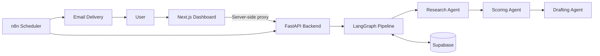

# ClientPilot

**AI-powered lead research, scoring, and outreach drafting, with a human approving every message.**

Freelancers lose hours researching companies and writing cold emails that sound generic. ClientPilot automates the research and first draft: it studies a company's website, scores how good a fit it is against a transparent rubric, and writes a personalized outreach draft based on what it found. Nothing is sent until a person reviews and approves it.

<!-- After you record it, uncomment this line and add your link:
**Demo video:** [Watch the 3-minute walkthrough](ADD_LINK_HERE)
-->

<!-- After you take a screenshot, save it as public/screenshot.png, then uncomment:

-->

## What It Does

1. **Researches** a company from its website: what it does, who it serves, and where its operations show gaps.
2. **Scores** the lead out of 100 using a fixed rubric (see [Lead Scoring](#lead-scoring)).
3. **Drafts** a short outreach email tied to specific findings, not generic templates.
4. **Waits for you.** Every draft is reviewed, edited, approved, or rejected in the dashboard before you send it manually.

## Key Features

- **Company research:** Extracts company information, target audience, and potential operational gaps from website content.
- **Lead scoring:** Evaluates industry fit, visible need, reachability, and evidence quality.
- **Personalized outreach:** Generates drafts connected to specific research findings.
- **Human approval:** Drafts can be reviewed, edited, approved, or rejected before manual sending.
- **Workflow automation:** n8n schedules pipeline runs and delivers approved drafts.
- **Evaluation suite:** Measures scoring accuracy, contact precision and recall, repeat-run consistency, and draft quality.
- **Security controls:** API-key authentication for backend requests and login protection for the dashboard.

## Architecture



### Technology Stack

| Component              | Technology                        |
| ---------------------- | --------------------------------- |
| Backend API            | Python, FastAPI                   |
| AI orchestration       | LangChain, LangGraph              |
| Language model         | Google Gemini API                 |
| Database               | Supabase                          |
| Frontend               | Next.js, TypeScript, Tailwind CSS |
| Workflow automation    | n8n                               |
| Testing                | pytest                            |
| Continuous integration | GitHub Actions                    |

## Lead Scoring

Each company receives a score out of 100 across four categories.

| Category         | Maximum points |
| ---------------- | -------------: |
| Industry fit     |             35 |
| Visible need     |             35 |
| Reachability     |             20 |
| Evidence quality |             10 |
| **Total**        |        **100** |

The current contact threshold is 50:

- **Below 50:** Skip the lead.
- **50 or above:** Mark the lead for contact, subject to the workflow's validation and human-review process.

The score supports decision-making. It does not guarantee that a company will become a client.

## Evaluation Results

**Initial evaluation run:** October 23, 2026
**Model:** `gemini-3.5-flash-lite`
**Scoring threshold:** 50

### Lead Scoring

| Metric                                            |   Result |
| ------------------------------------------------- | -------: |
| Cases attempted                                   |       20 |
| Cases completed                                   |       20 |
| Cases failed                                      |        0 |
| Overall decision accuracy                         |      95% |
| Clear-case accuracy                               |     100% |
| Borderline-case accuracy                          |      75% |
| Precision for contacted leads                     |      92% |
| Recall for good leads                             |     100% |
| Average score, expected good leads                |     69.5 |
| Average score, expected bad leads                 |     26.5 |
| Average total-score difference across repeat runs | 3 points |
| Maximum total-score difference across repeat runs | 6 points |

### Average Category-Score Differences

| Category         | Average absolute difference |
| ---------------- | --------------------------: |
| Industry fit     |                  1.2 points |
| Visible need     |                  1.2 points |
| Reachability     |                  0.6 points |
| Evidence quality |                    0 points |

### Outreach Drafting

| Metric                        |   Result |
| ----------------------------- | -------: |
| Drafts attempted              |        8 |
| Drafts completed              |        8 |
| Draft-generation failures     |        0 |
| Drafts passing quality checks |     100% |
| Average email body length     | 66 words |

The drafting checks flag unsupported numbers, banned phrases, and mismatches between the message and the researched company gaps.

**Evaluation limitations:** These results come from a small, project-authored evaluation set. Borderline labels involve judgment calls. The results help identify strengths and weaknesses, but they do not establish production-level performance on unseen companies.

## Design Decisions

- **Human in the loop:** Outreach drafts are reviewed before manual sending.
- **Structured output:** Agent responses use validated schemas.
- **Rules in code, judgment in the model:** The model evaluates lead fit, while application code applies the contact threshold.
- **Evidence-based scoring:** Scores reflect researched facts rather than unsupported assumptions about company needs, budgets, or hiring intentions.
- **Resumable workflow:** The pipeline can continue from a company's current status.
- **Security:** The dashboard uses a server-side proxy for authenticated backend requests. API keys stay on the server, never in browser-accessible code.
- **Reliability:** Retry handling, per-company run locks, structured logs, and health checks.

## Project Structure

```text
clientpilot/
├── .github/workflows/   # CI pipeline
├── app/                 # Next.js dashboard
├── backend/
│   ├── app/
│   │   ├── agents/      # Research, scoring, drafting agents
│   │   ├── main.py      # FastAPI entry point
│   │   ├── pipeline.py  # LangGraph pipeline
│   │   └── schemas.py   # Validated output schemas
│   ├── evals/
│   │   ├── cases.json
│   │   ├── run_eval.py
│   │   └── RESULTS.md
│   └── requirements.txt
├── n8n/                 # Workflow definitions
├── public/
├── package.json
└── README.md
```

## Run Locally

### Prerequisites

- Python 3.10+
- Node.js and npm
- Accounts and API credentials for the services you configure (Gemini, Supabase, n8n)

### 1. Clone the Repository

```bash
git clone https://github.com/MahamHayatDev/clientpilot.git
cd clientpilot
```

### 2. Set Up the Backend

```bash
cd backend

python -m venv venv

# Windows (PowerShell)
.\venv\Scripts\Activate.ps1
# macOS / Linux
# source venv/bin/activate

pip install -r requirements.txt

# Windows (PowerShell)
Copy-Item .env.example .env
# macOS / Linux
# cp .env.example .env
```

Fill in your environment variables in `backend/.env`, using the variable names from `.env.example`. Set a secure backend API key.

Start the backend:

```bash
uvicorn app.main:app --reload
```

### 3. Set Up the Dashboard

In a second terminal, from the project root:

```bash
npm install
```

Create `.env.local` in the project root with:

- `BACKEND_URL`
- `BACKEND_API_KEY` (must match the backend's API key)
- `DASHBOARD_USER`
- `DASHBOARD_PASSWORD`

Use a strong dashboard password and keep all secrets out of version control.

Start the dashboard:

```bash
npm run dev
```

Open `http://localhost:3000` in your browser.

## Tests and Evaluation

Run the backend tests:

```bash
cd backend
python -m pytest -q
```

Run the evaluation suite:

```bash
python -m evals.run_eval
```

Evaluation calls consume API quota and can be affected by provider rate limits. Review the generated report before updating the published metrics.

## Security Notes

- Never commit `.env`, `.env.local`, API keys, service-role keys, passwords, or other credentials.
- Keep backend credentials server-side.
- Use strong credentials for dashboard access.
- Review generated outreach before sending it.
- Treat company website content as untrusted input.

## Known Limitations

- Model results can vary between runs.
- The evaluation set is small and includes subjective borderline labels.
- Gemini API availability and rate limits can affect evaluation runs.
- n8n schedules depend on the configured n8n instance being available.
- The run lock is held in memory and is intended for a single application instance.
- Outreach is delivered for manual sending; automated reply tracking is not implemented.
- The project is not yet publicly hosted.

## Future Improvements

- Expand evaluation coverage with more real-world company examples.
- Improve borderline lead decisions and measure false-positive rates.
- Add more monitoring for model failures and pipeline execution.
- Add a public live demo.

## Author

Built by [Maham Shaukat](https://github.com/MahamHayatDev) as a practical AI automation project combining lead research, structured scoring, workflow orchestration, and human-reviewed outreach.